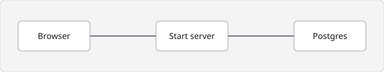

## Layout

<Files>
  <Folder name="src" defaultOpen>
    <Folder name="api" defaultOpen>
      <File name="app.ts" />
      <Folder name="services">
        <File name="pages/service.ts" />
      </Folder>
      <File name="mcp.ts" />
    </Folder>
    <Folder name="routes">
      <File name="dashboard.tsx" />
    </Folder>
  </Folder>
  <File name="vite.config.ts" />
</Files>



## Routes

Each action exposes one route. These are the ones the app serves:

<Endpoint
  method="POST"
  path="/api/pages/page/query"
  note="List the caller's pages"
/>
<Endpoint method="GET" path="/api/pages/page/{id}" note="Read one page" />
<Endpoint method="GET" path="/api/pages/public/{slug}" note="Public metadata" />

## Starting the app

<Tabs items={["Bun", "Node"]}>
  <Tab value="Bun">

```bash
bun run dev
```

  </Tab>
  <Tab value="Node">

```bash
npm run dev
```

  </Tab>
</Tabs>

```ts title="src/api/app.ts"
export function buildApp() {
  return brick({
    services: [pagesService],
    telemetry: true,
    documentation: {
      dir: "../../docs",
      components: "../../docs/components.tsx",
    },
  });
}
```

## Options

<TypeTable
  type={{
    dir: {
      description: "Folder of pages, relative to the project.",
      type: "string",
      required: true,
    },
    components: {
      description: "Module with extra MDX components.",
      type: "string",
    },
  }}
/>

<Accordions>
  <Accordion title="Why one server?">
    The API runs inside the Start server, so development needs a single process.
  </Accordion>
  <Accordion title="Where is auth?">
    Better Auth is mounted at `/api/auth/*`, ahead of the action routes.
  </Accordion>
</Accordions>
