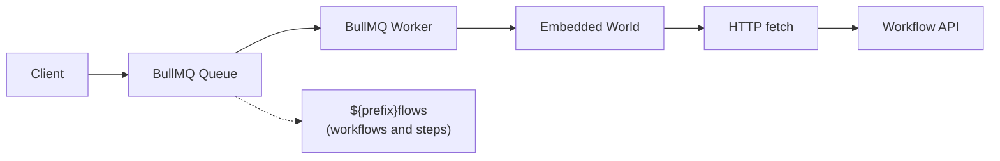
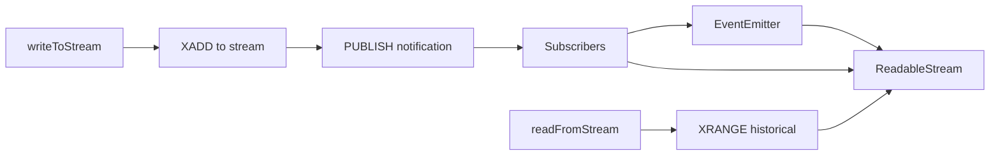

# How Redis-BullMQ World Works

This document explains the architecture and components of the Redis-BullMQ world implementation for workflow management.

This implementation uses **pure Redis** for all storage and operations. It leverages Redis data structures (hashes, sorted sets, streams) for efficient workflow management, BullMQ for job queue processing, and Redis Streams for real-time data streaming.

If you want to use a different Redis client or customize the data structures, you should be able to fork this implementation and modify the storage patterns.

## Architecture Overview

The Redis world consists of four main components:

1. **Storage Layer** - Redis hashes and sorted sets for workflow data
2. **Queue System** - BullMQ for reliable job processing
3. **Streaming** - Redis Streams for real-time data
4. **Embedded World** - Reuses local world for execution

## Storage Layer

### Data Structures

**Workflow Runs**

- Hash: `workflow:run:{runId}` - Stores run data as JSON
- Sorted Set: `workflow:runs:index` - All runs ordered by ULID
- Sorted Set: `workflow:runs:by_name:{workflowName}` - Index by workflow name
- Sorted Set: `workflow:runs:by_status:{status}` - Index by status

**Steps**

- Hash: `workflow:step:{runId}:{stepId}` - Stores step data as JSON
- Sorted Set: `workflow:steps:by_run:{runId}` - Steps for a run, ordered by ULID

**Events**

- Hash: `workflow:events:data:{runId}` - A run's log, `eventId -> event JSON`
- Sorted Set: `workflow:events:by_correlation:{runId}:{correlationId}` - Events for one step, hook, or wait, scored by position (a correlation id is only unique within its run)

**Hooks**

- Hash: `workflow:hook:{hookId}` - Stores hook data as JSON
- String: `workflow:hooks:by_token:{token}` - Maps token to hookId
- Sorted Set: `workflow:hooks:by_run:{runId}` - Hooks for a run

### Event IDs are log positions

An event id is `evnt_` followed by the event's 1-based position in its run's log, zero-padded to 26 digits. Runs and other entities still use ULIDs.

The log is dense: no position is skipped. Every Lua script that appends an event picks the position itself, as the hash length plus one, in the same atomic execution that writes the event. That is the whole concurrency story:

- **Uniqueness**: scripts run one at a time, so two writers never read the same length.
- **Density**: a position is taken only at the commit, so a failed write takes none.
- **Stale writers**: a writer that sends `eventCount` (how many events it has seen) expects position `eventCount + 1`. If that is taken it is not refused: it lands on the next free position and the response lists the events it skipped over (`events`, with `cursor: null` and `hasMore`). A writer that also sends `sinceCursor` gets an inline delta of everything after that cursor instead, which includes the skipped events.
- **Pagination**: a page is a run of consecutive positions, so a cursor is just an event id.

The event JSON goes to the script with a placeholder where the id belongs, and the script writes the real id in, so the stored value is exactly what a reader parses.

### Steps

A step's `status|attempt` lives in a small key next to it, and the script that writes a step event checks it atomically. A step that is already terminal takes no further write, and a `step_started` that read an older attempt than the step now has loses to the start that got there first. Two deliveries cannot both record an outcome.

A `step_started` that carries the step's name and input is a lazy start: it creates the step (already running), a synthetic `step_created`, and the `step_started` in one script, and only one concurrent caller wins.

## Job Queue System



### Queue Implementation

- **BullMQ Queue**: One queue, `{prefix}flows`; a step travels on it too
- **Workers**: Configurable concurrency (default: 10)
- **Job Processing**: Workers deserialize messages and re-queue to embedded world
- **Retry Logic**: 3 attempts with automatic retry
- **Idempotency**: Uses BullMQ jobId for deduplication
- **Job Cleanup**: Keeps last 100 completed, 1000 failed jobs

### Message Flow

1. Client calls `world.queue(queueName, message, opts)`
2. Message serialized with JsonTransport
3. Job added to BullMQ queue with jobId for idempotency
4. Worker picks up job
5. Worker deserializes message
6. Worker re-queues to embedded world
7. Embedded world makes HTTP fetch to execute workflow/step

## Streaming

Real-time data streaming via **Redis Streams** and **Redis Pub/Sub**:



### Stream Implementation

- **Storage**: Redis Streams (`workflow:stream:{name}`)
- **Notification**: Redis Pub/Sub channel (`workflow:stream_notify`)
- **Chunk IDs**: ULID-based for ordering (`chnk_${ULID}`)
- **Data Encoding**: Base64 for binary safety
- **EOF Signaling**: Special chunk with `eof: true`

### How Streaming Works

1. **Writing**: `XADD` appends chunk to stream, then `PUBLISH` notifies
2. **Reading**:
   - Load historical chunks with `XRANGE`
   - Subscribe to real-time notifications
   - Merge historical + real-time in order
3. **Ordering**: ULID comparison ensures correct sequence
4. **Buffering**: Buffer real-time chunks during historical load
5. **Cleanup**: Reference counting for subscriber management

## Setup

Call `world.start()` to initialize BullMQ workers. When `.start()` is called, workers begin listening to BullMQ queues. When a job arrives, workers make HTTP fetch calls to the embedded world endpoints (`.well-known/workflow/v1/flow`, or the route registered with `registerRoute`; with `registerHandler` the delivery stays in process) to execute the actual workflow logic.

In **Next.js**, the `world.start()` function needs to be added to `instrumentation.ts|js` to ensure workers start before request handling:

```ts
// instrumentation.ts

if (process.env.NEXT_RUNTIME !== "edge") {
  import("workflow/api").then(async ({ getWorld }) => {
    // start listening to the jobs
    await getWorld().start?.();
  });
}
```

## Performance Characteristics

### Strengths

- **Fast Reads**: Redis hashes provide O(1) lookups
- **Efficient Pagination**: Sorted sets enable O(log N) range queries
- **Real-time Streaming**: Redis Streams + Pub/Sub for low latency
- **Scalable Queuing**: BullMQ handles high throughput
- **Memory Efficient**: Compact binary serialization

### Considerations

- **Memory Usage**: All data in RAM (configure Redis persistence)
- **Sorted Set Overhead**: Each index adds memory cost
- **Pub/Sub Reliability**: Messages not persisted (use Streams for history)
- **Single-Instance Limits**: Redis Cluster is not supported, because the Lua scripts touch keys that do not share a hash slot. Scale the workers, not Redis
- **No Expiry**: Finished runs and their data are never removed

## Data Lifecycle

### Workflow Run Lifecycle

```
create (pending)
  v
update (running) - sets startedAt
  v
update (completed/failed/cancelled) - sets completedAt
```

### Step Lifecycle

```
create (pending, attempt=1)
  v
update (running) - sets startedAt
  v
update (completed/failed) - sets completedAt
  v
[retry] update (attempt=N)
```

### Stream Lifecycle

```
writeToStream (chunk)
  v
writeToStream (chunk)
  v
closeStream (eof=true)
```

## Embedded World Pattern

The Redis world uses the **embedded world pattern**:

1. BullMQ workers don't execute workflows directly
2. Instead, they re-queue to an embedded local world
3. Embedded world makes HTTP requests to workflow endpoints
4. This enables:
   - Hybrid architectures
   - World migration
   - Consistent execution model

## Error Handling

- **WorkflowAPIError**: Thrown for not found (404) and conflict (409)
- **Validation**: Entity existence checks before operations
- **Idempotency**: Prevents duplicate runs/steps/hooks
- **Retry Logic**: Built into BullMQ (3 attempts)
- **Worker Errors**: Logged but don't crash worker process

## Monitoring

### CLI Tool

```bash
workflow-redis-setup
```

Shows:

- Connection status
- Redis version
- Existing workflow keys count
- Data structure overview

### RedisInsight

Use RedisInsight (included in docker-compose) to:

- Browse keys and data structures
- Monitor memory usage
- View BullMQ queue metrics
- Inspect stream entries

### Metrics to Monitor

- **Memory Usage**: `INFO memory`
- **Key Count**: `DBSIZE`
- **Stream Length**: `XLEN workflow:stream:{name}`
- **Queue Depth**: BullMQ queue.count()
- **Worker Status**: BullMQ worker events

## Migration from world-postgres

If migrating from world-postgres:

1. Export workflow runs from PostgreSQL
2. Transform to JSON format
3. Import to Redis using pipeline
4. Update `WORKFLOW_TARGET_WORLD` environment variable
5. Restart application with `world.start()`

Note: Data structures are compatible, but storage format differs.
