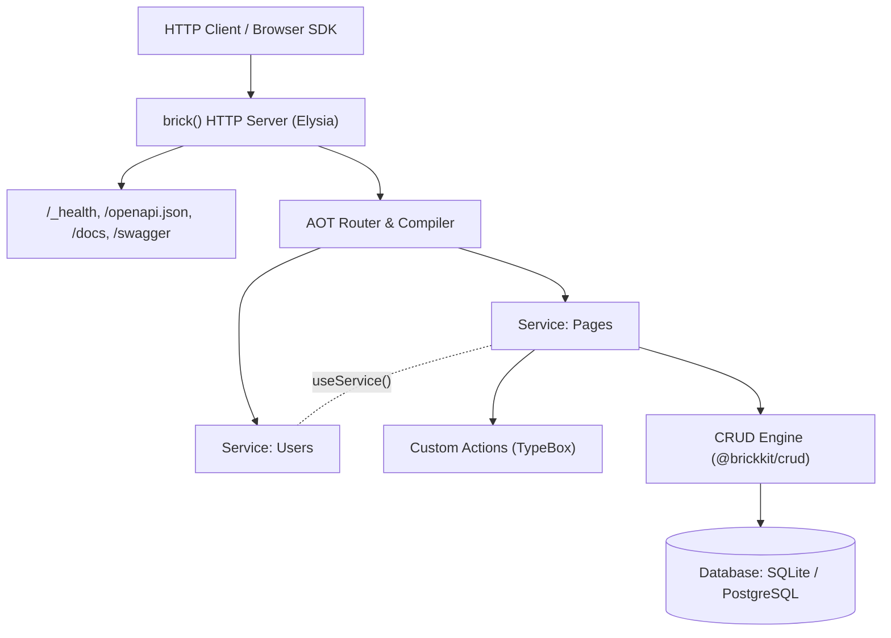

Brick-TS is a TypeScript backend framework built on Bun, Elysia, TypeBox, and Drizzle that delivers monomorphic in-process execution with automatic HTTP and OpenAPI exposure.

## Minimal Example

Define a database, register a service, attach a declarative CRUD resource with explicit field policies, and start the HTTP server in a single file:

```ts title="src/server.ts"
import {
  brick,
  defineDatabase,
  defineService,
  sqliteTable,
  text,
} from "@brickkit/core";
import { crud } from "@brickkit/crud";

// 1. Declare schema with Drizzle
export const pages = sqliteTable("pages", {
  id: text("id")
    .primaryKey()
    .$defaultFn(() => crypto.randomUUID()),
  title: text("title").notNull(),
  content: text("content"),
});

// 2. Configure database and service
const database = defineDatabase({ tables: { pages } });
export const pagesService = defineService("pages", { database });

// 3. Attach CRUD with explicit access policy and field permissions
pagesService.resource({ name: "page", table: pages, id: pages.id }).use(
  crud({
    access: "public",
    fields: {
      id: { read: true, filter: ["eq"] },
      title: {
        read: true,
        create: true,
        update: true,
        filter: ["eq", "contains"],
        sort: true,
      },
      content: { read: true, create: true, update: true },
    },
  }),
);

// 4. Mount the service mesh onto an Elysia HTTP server
const app = brick({ services: [pagesService] });
app.listen(4000);
console.log("Server listening on http://localhost:4000");
```

### Schema

These columns match the Drizzle tables in the example. Defaults marked as application defaults run in Drizzle, rather than in SQL.

export const pagesSchemaFields = [
  {
    name: "id",
    type: "text",
    description: "Row identifier.",
    isPrimaryKey: true,
    defaultValue: "crypto.randomUUID() (application)",
  },
  {
    name: "title",
    type: "text",
    description: "Display title.",
  },
  {
    name: "content",
    type: "text",
    description: "Page content.",
    isOptional: true,
  },
];

<DatabaseTable name="pages" fields={pagesSchemaFields} />

## Architectural Mental Model

Brick-TS unifies monolithic developer ergonomics with distributed system boundaries:



### 1. Logical Monolith, Physical Microservices

Build your application in a single repository with shared TypeScript types and instant jump-to-definition. Services can execute actions in-process without network overhead or data serialization. If an application grows into separate microservices, actions retain identical input/output schemas and authorization rules.

### 2. Monomorphic In-Process Dispatch

In Brick-TS, an action is a callable TypeScript function and an HTTP endpoint simultaneously. Calling `pagesService.getAction("page.get")({ input: { id: "1" } })` executes in-process through the exact same validation, authorization, and error handling pipeline that HTTP requests navigate, without HTTP loopback latency.

### 3. Pure TypeScript Type Inference

Brick-TS eliminates code generation build steps. Type definitions flow directly from runtime TypeBox schemas (`Static<typeof Schema>`) and Drizzle database models (`$inferSelect`, `$inferInsert`). Frontend clients infer the backend contract through type imports.

### 4. Deny-by-Default Security

Security policies are mandatory and explicit:

- **CRUD Operations**: Reject all access unless explicitly configured with `access: "public"` or an `access: { authorize, scope }` policy.
- **Field Exposure**: Columns remain hidden from reads, filters, sorting, and writes until explicitly enabled in the field policy.
- **Context Isolation**: In-process service proxies execute inside the recipient service's isolated context and database connection, preventing callers from overriding security resolvers.

## Framework Packages

The framework is published as three modular packages at `v0.3.0`:

| Package          | Purpose                                                                                 | Imports                                                                         |
| :--------------- | :-------------------------------------------------------------------------------------- | :------------------------------------------------------------------------------ |
| `@brickkit/core` | Core runtime, services, actions, database handles, HTTP server, and client SDK          | `defineService`, `defineAction`, `defineDatabase`, `brick`, `createBrickClient` |
| `@brickkit/crud` | Deny-by-default declarative CRUD engine with field policies, filtering, and hooks       | `crud`                                                                          |
| `@brickkit/cli`  | Development server with live reload, production build compiler, and artifact generators | `brick` CLI binary (`dev`, `start`, `build`, `gen`, `info`)                     |
