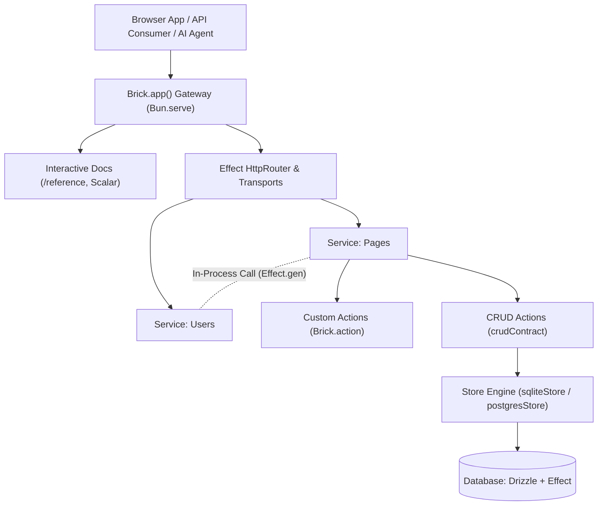

Brick-TS is an Effect-native TypeScript backend platform built on Bun, Effect, Effect Schema, and Drizzle ORM that delivers monomorphic in-process execution with automatic HTTP, RPC, MCP, and OpenAPI exposure.

## Minimal Example

Define a Drizzle database table, configure a declarative CRUD contract with field policies, register an immutable service, and compose the scoped application in a single file:

```ts title="src/server.ts"
import { Brick } from "@brickkit/core";
import { crudContract, database, sqliteStore } from "@brickkit/crud";
import { sqliteTable, text } from "drizzle-orm/sqlite-core";
import { drizzle } from "drizzle-orm/libsql";
import { Effect, Layer } from "effect";

// 1. Declare schema with Drizzle
export const pages = sqliteTable("pages", {
  id: text("id")
    .primaryKey()
    .$defaultFn(() => crypto.randomUUID()),
  title: text("title").notNull(),
  content: text("content"),
});

// 2. Define the scoped database service and layer
export interface DatabaseService {}
export const { Service: PagesDb, layer: DatabaseLive } =
  database<DatabaseService>()(
    "PagesDb",
    Effect.sync(() => drizzle({ connection: ":memory:" })),
  );

// 3. Define the CRUD contract with explicit access and field policies
export const pageContract = crudContract({
  name: "page",
  path: "/api/page",
  table: pages,
  id: "id",
  errors: [],
  fields: {
    id: { read: true, filter: ["eq"] },
    title: {
      read: true,
      create: true,
      update: true,
      filter: ["eq", "contains"],
      sort: true,
    },
    content: { read: true, create: true, update: true },
  },
});

const pageActions = pageContract.implement({
  store: sqliteStore(pages, PagesDb),
  access: "public",
});

// 4. Register the immutable service
export const pagesService = Brick.service("pages", {
  actions: pageActions,
});

// 5. Compose the closed, scoped application
export const app = Brick.app({
  services: [pagesService],
  layer: DatabaseLive,
  docs: { path: "/reference" },
});

export default app;
```

### Schema

These columns match the Drizzle tables in the example. Defaults marked as application defaults run in Drizzle, rather than in SQL.

export const pagesSchemaFields = [
  {
    name: "id",
    type: "text",
    description: "Row identifier.",
    isPrimaryKey: true,
    defaultValue: "crypto.randomUUID() (application)",
  },
  {
    name: "title",
    type: "text",
    description: "Display title.",
  },
  {
    name: "content",
    type: "text",
    description: "Page content.",
    isOptional: true,
  },
];

<DatabaseTable name="pages" fields={pagesSchemaFields} />

## Architectural Mental Model

Brick-TS unifies monolithic developer ergonomics with distributed system boundaries:



### 1. Logical Monolith, Physical Microservices

Build your application in a single codebase with shared TypeScript types, instant jump-to-definition, and zero network latency. Services execute actions in-process without network overhead or data serialization. If an application grows into separate microservices, actions retain identical input/output schemas and authorization rules.

### 2. Monomorphic In-Process & HTTP Dispatch

In Brick-TS, an action is a callable TypeScript function returning an `Effect` and an HTTP endpoint simultaneously. Calling an action directly executes in-process through the exact same schema validation, authorization, and error handling pipeline that HTTP requests navigate, with zero network loopback latency.

### 3. Effect Schema & Type Inference

Brick-TS eliminates fragile code generation steps. Type definitions flow directly from runtime Effect Schemas (`Schema.Top["Type"]`) and Drizzle database models (`InferSelectModel<T>`, `InferInsertModel<T>`). Frontend clients infer the backend contract through lightweight, browser-safe schema modules without importing backend drivers.

### 4. Deny-by-Default Security

Security policies are mandatory and explicit:

- **CRUD Operations**: Reject all access unless explicitly configured with `access: "public"` or an `access: { authorize, scope }` policy.
- **Field Exposure**: Columns remain hidden from reads, filters, sorting, and writes until explicitly enabled in the field policy.
- **Dependency Isolation**: In-process calls run through Effect's typed requirement channel (`R`), ensuring all required database handles and authentication dependencies are supplied via Layers at application compile time.

## Framework Packages

The framework is published as four modular packages:

| Package                    | Purpose                                                                                 | Key Imports                                                                |
| :------------------------- | :-------------------------------------------------------------------------------------- | :------------------------------------------------------------------------- |
| `@brickkit/core`           | Core runtime, services, actions, endpoints, routes, scoped app, and typed errors        | `Brick`, `secret`, `isNativeBrickApp`                                      |
| `@brickkit/core/contracts` | Browser-safe contracts, schema-only actions, and standard TaggedError classes           | `action`, `endpoint`, `BadRequest`, `Unauthorized`, `NotFound`, `Conflict` |
| `@brickkit/crud`           | Deny-by-default declarative CRUD engine with field policies, stores, and hooks          | `crudContract`, `crud`, `sqliteStore`, `postgresStore`, `database`         |
| `@brickkit/client`         | Browser and Node HTTP client generating typed Promise and Effect clients from schemas   | `createClient`, `createEffectClient`                                       |
| `@brickkit/cli`            | Development server with live reload, production bundling, and client contract generator | `brick` CLI binary (`dev`, `start`, `build`, `gen`, `info`)                |

## Documentation Guides

<Cards>
  <Card title="Quickstart" href="/docs/quickstart">
    Build and run an action in under 5 minutes.
  </Card>
  <Card title="Tutorial" href="/docs/tutorial">
    Build an end-to-end REST API with database models, relations, and
    authorization.
  </Card>
  <Card title="Services and Actions" href="/docs/services-and-actions">
    Explore typed actions, in-process execution, and route mapping.
  </Card>
  <Card title="For AI Agents" href="/docs/for-ai-agents">
    Equip AI coding agents with documentation, project instructions, and MCP
    tools.
  </Card>
</Cards>
