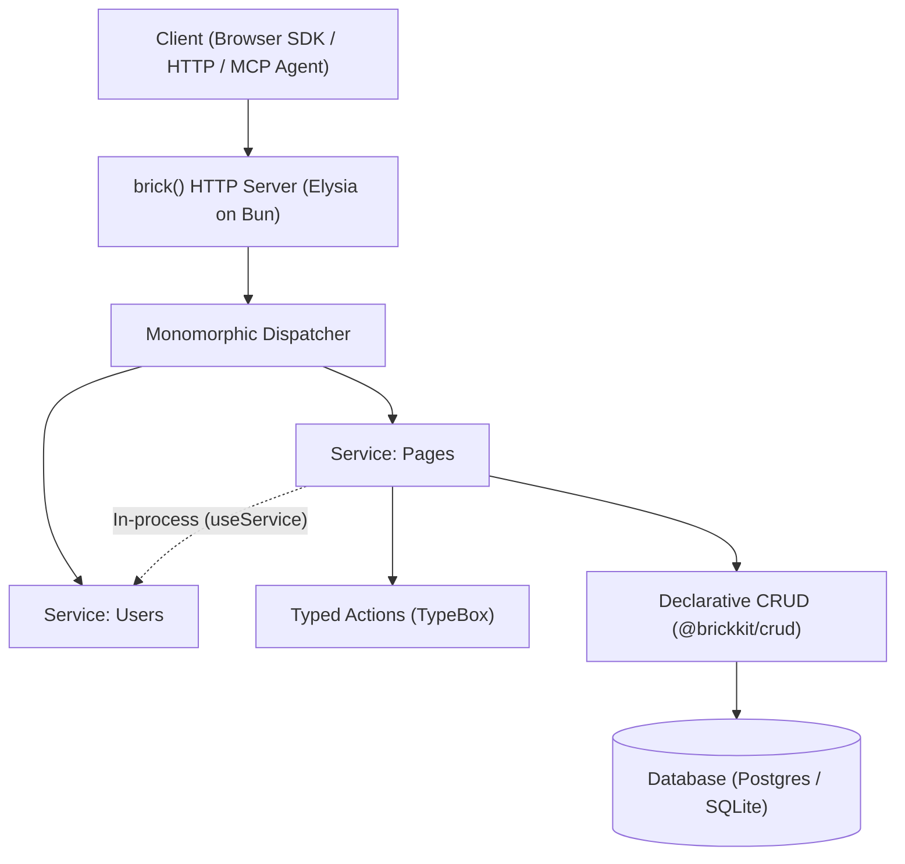

Most backend frameworks solve HTTP routing and leave the rest to you. Where does business logic belong? How are inputs and outputs validated? How does authorization compose? How do internal services call each other without network latency or serialization overhead? How do you prevent OpenAPI drift, maintain typed frontend clients, and expose capabilities to AI agents without maintaining duplicate glue code?

Those are your problems. Express, Fastify, Hono, and Elysia don't have an opinion—they match HTTP verbs and pathnames to callback functions.

## The Architecture Problem

The consequence of router-only frameworks is predictable. Every engineering team invents a custom backend architecture from scratch:

- **Validation is smeared**: Body checks, parameter sanitization, and response shaping are scattered across route controllers, middleware chains, or ad-hoc schema libraries.
- **Authorization is precarious**: Access controls hide inside nested middleware stacks or deep inside database queries. A single omitted middleware or misconfigured route guard silently opens security holes.
- **The "Monolith vs. Microservices" false dichotomy**: Teams either build an untyped monolith—where services directly mutate each other's database tables and bypass domain logic—or jump prematurely to microservices, paying the brutal tax of network serialization, HTTP loopback latency, independent deployments, and distributed transaction failures.
- **Contract and tooling drift**: OpenAPI documentation, frontend client fetchers, and AI agent tool manifests are manually maintained or assembled from fragile, multi-step codegen pipelines that fall out of sync with real production behavior.

This is why clean, scalable TypeScript backend codebases are vanishingly rare. Maintaining a growing TypeScript backend usually requires Staff-level engineers to establish bespoke conventions, police them in every code review, and fight architectural decay for years.

Fast HTTP routers aren't bad. They are great. They are also insufficient.

## A Fixed Answer

What if there were no decisions to make about how to structure your backend application? Not because someone took choice away, but because the right answer was the only answer.

What if backend architecture was solved?

**That is Brick.**

Every Brick application has the same architecture. Not by convention. **By design.**



## Power Through Constraints

Brick replaces fragmented conventions with foundational architectural primitives:

### 1. Isolated Service Boundaries

In Brick, domain boundaries are explicit. Services are declared with `defineService(name, options)` and act as the single owner of their domain logic, database tables, and access rules:

- A service owns its database connection and schema models.
- Services cannot arbitrarily bypass each other's security policies or reach into foreign tables.
- Cross-service communication happens through typed service references (`useService()`), preserving domain boundaries whether running in the same process today or separated into independent services tomorrow.

### 2. Actions as Atomic Capabilities

An action is the fundamental unit of computation in Brick. Instead of scattering route handlers, validation logic, authorization checks, and error formatting across multiple files, `defineAction()` bundles them into a single, cohesive definition:

```ts title="src/services/billing.ts"
import { defineAction, defineService, t } from "@brickkit/core";

export const billingService = defineService("billing");

export const chargeInvoice = billingService.action({
  name: "chargeInvoice",
  input: t.Object({
    invoiceId: t.String(),
    amount: t.Integer({ minimum: 1 }),
  }),
  output: t.Object({
    status: t.Union([t.Literal("succeeded"), t.Literal("pending")]),
    transactionId: t.String(),
  }),
  authorize: ({ user }) => Boolean(user?.canManageBilling),
  execute: async ({ input, ctx, error }) => {
    // Business logic runs only after input validation and authorization pass
    return { status: "succeeded", transactionId: "txn_123" };
  },
});
```

Every action declares its contract up front. If input validation fails, the action rejects early with structured errors. If authorization fails, execution halts before domain logic runs.

### 3. Monomorphic In-Process & HTTP Dispatch

In traditional frameworks, if `Service A` needs to trigger logic inside `Service B`, you must choose between making an expensive HTTP network loopback call (incurring serialization, latency, and socket overhead) or directly importing an unvalidated internal function (bypassing authorization and input guarantees).

Brick solves this with **monomorphic execution**:

- An action is an HTTP route and a callable TypeScript function at the same time.
- Calling `chargeInvoice({ input: { ... } })` executes in-process through the **exact same validation, authorization, and error handling pipeline** as an incoming HTTP `POST /api/billing/charge-invoice` request.
- Zero network serialization penalty. Zero HTTP loopback overhead. 100% guarantee that authorization rules and validation schemas are always enforced.

### 4. Deny-by-Default Declarative CRUD

Most data breaches happen when internal columns (like password hashes, internal roles, or billing identifiers) leak through over-fetching or unauthorized updates.

Brick's `@brickkit/crud` plugin enforces deny-by-default security:

- Tables attached to a service expose **nothing** by default.
- Reads, creates, updates, filters, and sorts must be explicitly opted into per field.
- Access policies (`public` vs. custom `authorize` predicates) are evaluated before database queries touch the driver.

```ts title="src/services/pages.ts"
pagesService.resource({ name: "page", table: pages, id: pages.id }).use(
  crud({
    access: {
      authorize: ({ ctx }) => Boolean(ctx.user),
    },
    fields: {
      id: { read: true, filter: ["eq"] },
      title: { read: true, create: true, update: true, filter: ["contains"] },
      published: { read: true, update: true },
      // internalNotes is omitted: impossible to read, query, or mutate via API
    },
  }),
);
```

### 5. Automated, Isolated Client Contracts

End-to-end type safety between frontend and backend is often fraught with friction:

- Direct TypeScript type imports (like basic RPC frameworks) risk leaking backend-only modules, database drivers (`drizzle-orm`, `node:sqlite`, `pg`), and server secrets into frontend browser bundles.
- Traditional codegen tools (like OpenAPI generators or GraphQL compilers) require manual CLI steps, generate bloated SDK wrappers, and constantly drift from real production behavior.

Brick solves this through **automated contract extraction**:

- The `@brickkit/cli/vite` plugin hooks directly into Vite's dev server and build pipeline. It extracts browser-safe transport types and route metadata directly from your `BrickApp` into a lightweight, gitignored `_brick/contract.ts`.
- When backend actions or schemas change, Vite HMR regenerates the contract instantly in the background.
- The browser client uses `createBrickClient({ contract })`, giving frontend developers full autocomplete, parameter validation, and typed responses without manual codegen commands or runtime bundle leaks.

## Focus on Behavior, Not Plumbing

When architectural plumbing is off the table, development elevates from implementation trivia to core domain behavior:

- Not _"How do we wire middleware to authenticate this endpoint and parse query params?"_ but **"What are the input boundaries and permission rules for this action?"**
- Not _"Should we build microservices or a monolith?"_ but **"What service owns this capability?"** (Brick lets you develop as a logical monolith today with shared types and zero network latency, while preserving the clean physical boundaries needed to split services tomorrow).
- Not _"How do we keep OpenAPI schemas, frontend SDKs, and Swagger docs in sync?"_ but **"What capabilities does our product offer?"**

## Readable by Design

### Readable to Developers

Any developer can walk into any Brick codebase and immediately navigate:

1. **Services** declare the system boundaries (`defineService`).
2. **Actions** define all business operations with explicit TypeBox schemas (`defineAction`).
3. **Resources** define database persistence with declarative field policies (`service.resource`).
4. **Clients** consume typed endpoints via `createBrickClient`—with automated contract synchronization and complete browser/server bundle isolation.

Because the framework enforces this structure, there is no ambiguity about where logic lives, how errors are surfaced, or how data flows.

### Readable to AI Agents

The exact properties that make Brick codebases legible to developers make them exceptionally powerful for AI agents:

- **Predictable mental model**: Coding agents (Cursor, Claude Code, Copilot) don't hallucinate arbitrary middleware order or complex controller layers. The pattern is always Service → Action / Resource → Handler.
- **Architecture Introspection**: With `brick info src/app.ts`, Brick exports the complete service graph, registered action routes, access rules, and database schema into structured JSON that agents can inspect.
- **Native Model Context Protocol (MCP)**: Every service can expose its actions and tools directly to AI workflows using `createMcpRegistry` and `createMcpHandler`, turning your backend into an agent-ready tool platform with zero manual wrapping.

## How Brick Compares

| Dimension              | Raw Routers (Hono, Elysia, Express) | Fullstack RPC (tRPC)      | Enterprise Frameworks (NestJS) | Brick-TS                            |
| :--------------------- | :---------------------------------- | :------------------------ | :----------------------------- | :---------------------------------- |
| **Primary Focus**      | Request/response routing            | End-to-end type safety    | Dependency injection & OOP     | Complete service architecture       |
| **Domain Boundaries**  | Ad-hoc / Unstructured               | Monolithic routers        | Modules & Decorators           | Explicit isolated services          |
| **Internal Execution** | HTTP loopback or direct import      | Monolith procedure call   | In-memory DI services          | Monomorphic in-process dispatch     |
| **CRUD & Data Access** | Manual ORM glue                     | Manual queries            | Repositories & DTOs            | Deny-by-default declarative CRUD    |
| **Client Type Safety** | Manual fetch / OpenAPI codegen      | Inferred types (RPC-only) | Generated OpenAPI / SDKs       | Automated contract (Vite HMR / CLI) |
| **AI & MCP Support**   | None (manual)                       | None (manual)             | None (manual)                  | Built-in MCP registry & tools       |
| **Runtime Engine**     | Varies (Node/Bun/Edge)              | Node / Edge               | Node.js                        | Bun + Elysia + TypeBox + Drizzle    |

## Build Your Product, Not Your Architecture

Backend development should be about solving business problems, not assembling repetitive infrastructure. Time spent debugging middleware precedence, hand-writing CRUD endpoints, fixing serialization bugs, and keeping client contracts in sync is pure overhead.

Brick models the backend so you can model your business:

- **Services, Actions, Resources, Field Policies, Type Inference, OpenAPI, and MCP Agents.**
- All accounted for.
- All connected.
- All typed.
- All in one place.

Backend architecture is solved. The only question left is: **what are you going to build?**

## Next Steps

- Explore the [Mental Model & Overview](/docs) for architecture details.
- Build a runnable API in under 5 minutes with the [Quickstart](/docs/quickstart).
- Follow the step-by-step [REST API Tutorial](/docs/tutorial).
- Learn how to integrate AI tools in [For AI Agents](/docs/for-ai-agents) and [Tools & MCP](/docs/tools-and-mcp).
