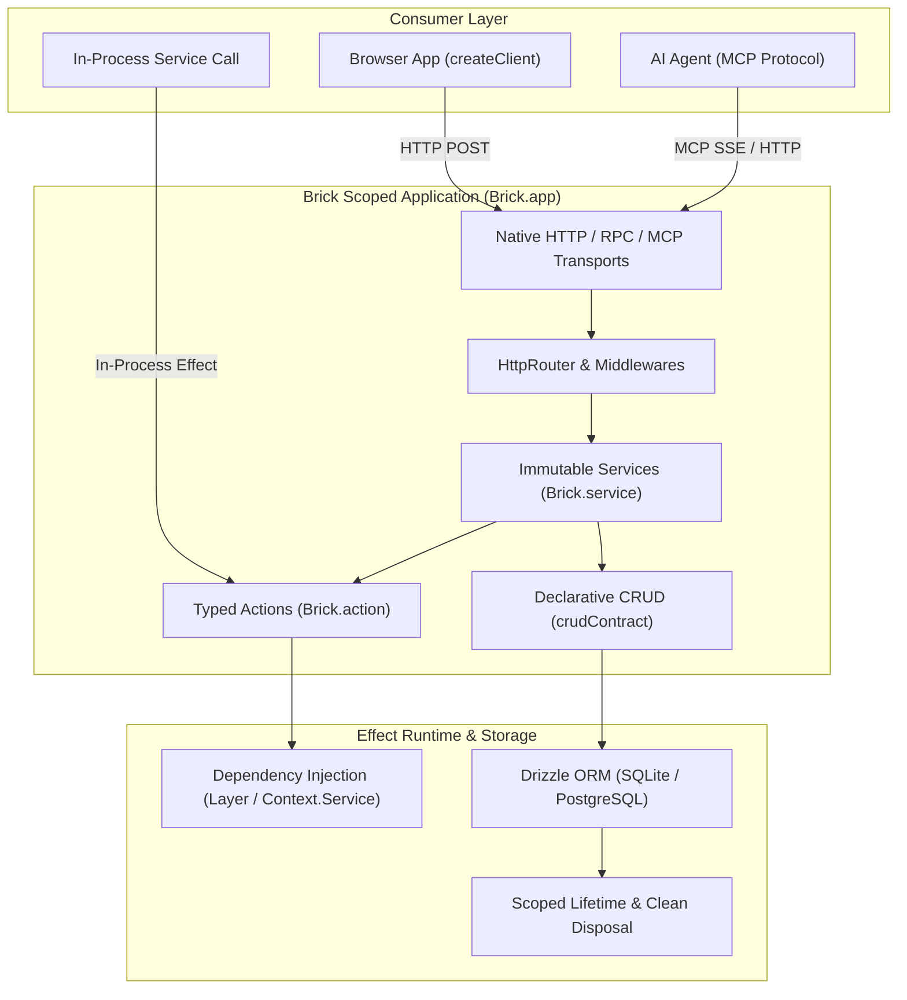

Brick was built to solve the architectural fragmentation of modern TypeScript backend development.

When building backends today, developers are forced to manually stitch together disparate libraries: a router for HTTP endpoints, an ORM for database queries, a validation library for payloads, separate RPC tooling for frontend communication, custom glue for AI agent tooling, and ad-hoc error handling across boundaries. The result is architectural drift, boilerplate plumbing, security vulnerabilities from leaked internal columns, and frontend bundles that accidentally import server-only database drivers.

Brick models the entire backend around **first-class Effect contracts, immutable services, and scoped applications**.

## Core Architectural Pillars



### 1. Unified Services & Pure Boundaries

In typical router-centric architectures, backend logic dissolves into disconnected route files, arbitrary middleware chains, and scattered utility functions.

Brick structures systems around **explicit, immutable services** created with `Brick.service()`. A service defines a cohesive domain boundary grouping business actions and database resources. Actions are registered immutably, ensuring complete type safety across transports.

```ts title="src/services/billing.ts"
import { Brick } from "@brickkit/core";
import { chargeCard } from "./actions/charge";
import { getInvoice } from "./actions/invoice";

export const billingService = Brick.service("billing", {
  actions: { chargeCard, getInvoice },
});
```

### 2. Explicit Contracts & Typed Domain Errors

Most API frameworks treat errors as untyped exceptions or vague HTTP status numbers. When an operation fails, callers must guess whether the error was a validation issue, a permission failure, or an internal server defect.

Brick pairs **Effect Schema** contracts with **`Schema.TaggedError`** classes. Every action declares its input schema, output schema, and the exact set of typed errors it can produce:

```ts title="src/services/actions/charge.ts"
import { Brick } from "@brickkit/core";
import { Schema, Effect } from "effect";

export class InsufficientFunds extends Schema.TaggedError<InsufficientFunds>()(
  "InsufficientFunds",
  { message: Schema.String, balance: Schema.Number, required: Schema.Number },
  { httpApiStatus: 400 },
) {}

export class CardExpired extends Schema.TaggedError<CardExpired>()(
  "CardExpired",
  { message: Schema.String },
  { httpApiStatus: 400 },
) {}

export const chargeCard = Brick.action("chargeCard", "/api/billing/charge", {
  input: Schema.Struct({
    cardId: Schema.String,
    amount: Schema.Number,
  }),
  output: Schema.Struct({
    transactionId: Schema.String,
    status: Schema.String,
  }),
  errors: [InsufficientFunds, CardExpired],
})((input) =>
  Effect.gen(function* () {
    // Business logic runs with full type inference for input and errors
    if (input.amount > 5000) {
      return yield* Effect.fail(
        new InsufficientFunds({
          message: "Transaction limit exceeded",
          balance: 5000,
          required: input.amount,
        }),
      );
    }
    return { transactionId: "txn_123", status: "succeeded" };
  }),
);
```

Every action declares its contract up front. If input validation fails, the request rejects early with a structured 400 error. If a domain error occurs, it maps automatically to its declared HTTP status while preserving the tagged failure structure on the wire.

### 3. Monomorphic In-Process & HTTP Dispatch

In traditional architectures, if `Service A` needs to trigger logic inside `Service B`, you must choose between an expensive HTTP loopback call (incurring serialization, latency, and socket overhead) or importing an unvalidated internal function (bypassing authorization and schema guarantees).

Brick solves this with **monomorphic execution**:

- An action is both an HTTP endpoint and a callable TypeScript function returning an `Effect`.
- Calling `chargeCard(input)` executes in-process through the **exact same validation, error handling, and OpenTelemetry tracing pipeline** as an incoming HTTP `POST /api/billing/charge` request.
- Zero network serialization overhead. Zero loopback latency. 100% guarantee that validation schemas and error types are always enforced.

### 4. Deny-by-Default Declarative CRUD

Most data leaks occur when internal database columns (such as password hashes, role flags, or internal IDs) leak through over-fetching or unauthorized mutation.

Brick's `@brickkit/crud` package enforces deny-by-default data access:

- Database tables attached to a service expose **nothing** by default.
- Reads, creates, updates, filters, and sorts must be explicitly opted into per field.
- Access policies (`"public"` vs. custom `authorize` predicates and SQL `scope` functions) run before queries touch the database.

```ts title="src/services/pages.ts"
import { crudContract, sqliteStore } from "@brickkit/crud";
import { Unauthorized } from "@brickkit/core/contracts";
import { pagesTable } from "./schema";
import { PagesDb } from "./db";
import { Effect } from "effect";
import { eq } from "drizzle-orm";

export const pageContract = crudContract({
  name: "page",
  path: "/api/pages/page",
  table: pagesTable,
  id: "id",
  errors: [Unauthorized],
  fields: {
    id: { read: true, filter: ["eq"] },
    title: {
      read: true,
      create: true,
      update: true,
      filter: ["contains"],
      sort: true,
    },
    content: { read: true, create: true, update: true },
    // internalNotes is omitted: impossible to read, query, or mutate via API
  },
});

export const pageActions = pageContract.implement({
  store: sqliteStore(pagesTable, PagesDb),
  access: {
    authorize: () => Effect.succeed(true),
    scope: ({ operation }) => Effect.succeed(undefined),
  },
});
```

### 5. Automated, Isolated Client Contracts

End-to-end type safety between frontend and backend is often fraught with friction:

- Direct TypeScript type imports from server files risk leaking backend-only modules, database drivers (`drizzle-orm`, `@libsql/client`, `pg`), and server secrets into frontend browser bundles.
- Traditional codegen tools require manual CLI steps, generate bloated SDK wrappers, and constantly drift from real production behavior.

Brick solves this through **clean contract separation and typed clients**:

- The client contract is a lightweight, browser-safe schema module exporting an `HttpApi` definition without importing server implementations or database drivers.
- The `brick gen client` CLI command (and Vite integration) validates that the browser contract matches the server application's OpenAPI endpoints.
- Browser applications consume endpoints via `createClient(Api, { baseUrl })`, providing autocomplete, parameter validation, and typed responses with complete bundle isolation.

## Focus on Behavior, Not Plumbing

When repetitive infrastructure is solved by design, development elevates from implementation trivia to core domain behavior:

- Not _"How do we wire middleware to parse parameters and format error responses?"_ but **"What are the input boundaries and failure modes for this action?"**
- Not _"Should we build microservices or a monolith?"_ but **"What service owns this capability?"** (Brick lets you develop as a logical monolith today with shared types and zero network latency, while preserving the clean physical boundaries needed to split services tomorrow).
- Not _"How do we keep OpenAPI specs, Swagger docs, and frontend SDKs in sync?"_ but **"What capabilities does our product offer?"**

## Readable by Design

### Readable to Developers

Any developer can navigate a Brick codebase and immediately understand the architecture:

1. **Services** declare the system boundaries (`Brick.service`).
2. **Actions** define all business operations with Effect Schema contracts (`Brick.action`).
3. **Resources** define database persistence with declarative field policies (`crudContract`).
4. **Clients** consume typed endpoints via `createClient` with complete browser/server bundle isolation.

Because the framework enforces this structure, there is no ambiguity about where logic lives, how errors are surfaced, or how dependencies are wired.

### Readable to AI Agents

The properties that make Brick codebases legible to developers make them exceptionally powerful for AI agents:

- **Predictable mental model**: Coding agents (Cursor, Claude Code, Copilot) don't hallucinate arbitrary middleware order or complex controller layers. The pattern is always Service → Action / Resource → Effect Handler.
- **Architecture Introspection**: With `brick info src/app.ts` or `brick build`, Brick exports the complete service graph, registered action routes, and metadata into structured JSON (`brick-ir.json`) that agents can inspect.
- **Native Model Context Protocol (MCP)**: Every action can be exposed directly to AI workflows using `expose: "both"` (or `"mcp"` for tool-only actions with no HTTP route) and tool annotations, turning your backend into an agent-ready tool platform with zero manual wrapping.

## How Brick Compares

| Dimension              | Raw Routers (Hono, Express)    | Fullstack RPC (tRPC)      | Enterprise Frameworks (NestJS) | Brick-TS                                  |
| :--------------------- | :----------------------------- | :------------------------ | :----------------------------- | :---------------------------------------- |
| **Primary Focus**      | Request/response routing       | End-to-end type safety    | Dependency injection & OOP     | Complete service architecture             |
| **Domain Boundaries**  | Ad-hoc / Unstructured          | Monolithic routers        | Modules & Decorators           | Explicit isolated services                |
| **Internal Execution** | HTTP loopback or direct import | Monolith procedure call   | In-memory DI services          | Monomorphic in-process Effect dispatch    |
| **CRUD & Data Access** | Manual ORM glue                | Manual queries            | Repositories & DTOs            | Deny-by-default declarative CRUD          |
| **Client Type Safety** | Manual fetch / OpenAPI codegen | Inferred types (RPC-only) | Generated OpenAPI / SDKs       | Browser-safe contracts & `createClient`   |
| **AI & MCP Support**   | None (manual)                  | None (manual)             | None (manual)                  | Built-in MCP transport & tool annotations |
| **Runtime Engine**     | Node / Bun / Edge              | Node / Edge               | Node.js                        | Bun + Effect + Effect Schema + Drizzle    |

## Build Your Product, Not Your Architecture

Backend development should be about solving business problems, not assembling repetitive infrastructure. Time spent debugging middleware precedence, hand-writing CRUD endpoints, fixing serialization bugs, and keeping client contracts in sync is pure overhead.

Brick models the backend so you can model your business:

- **Services, Actions, Resources, Field Policies, Effect Schemas, OpenAPI, and MCP Agents.**
- All accounted for.
- All connected.
- All typed.
- All in one place.
