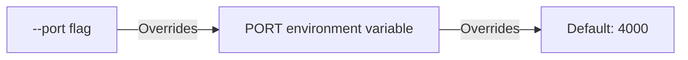

The `brick dev` and `brick start` commands run your service mesh with automatic route discovery, port validation, and live reload.

## Development Server (`brick dev`)

Start local development with recursive file watching and debounced server restarts:

```bash
brick dev src/server.ts --port 4000
```

### Live Reload Behavior

When running `brick dev`:

1. **Entry File Loading**: The CLI resolves the application entry file. If an entry file path is provided but does not exist, the CLI exits immediately with an error.
2. **Watch Directories**: The CLI monitors `src/`, `app/`, and the parent folder of the entry file for changes (excluding `node_modules`). With a [`brick.config.ts`](/docs/brick-cli/config), it also watches the `services` folder and rewrites [`services.gen.ts`](/docs/project-structure#the-services-manifest) before the restart, so an added or removed definition file is registered.
3. **Fresh Application Process**: After a short debounce, `brick dev` stops the application process and starts a new one. The entry and all its dependencies run again with a fresh service registry and module graph. Default-exported `BrickApp` options (including the route prefix) are preserved; the CLI port takes precedence. For the programmatic `startDevServer({ prefix })` option, the exported app’s prefix takes precedence and the runner prints a warning.

### Generate contracts before frontend startup

For a separate frontend tool, pass a contract destination and a frontend command:

```bash
brick dev src/api/app.ts --client frontend/src/contract.ts --frontend 'bun run --cwd frontend dev'
```

The entry must default-export a `BrickApp` without calling `.listen()`. Keep startup jobs outside that module because generation evaluates it.

`--client <file>` generates the contract before starting the backend. `--frontend <command>` starts the frontend once, after the first successful contract write. Entry and contract paths are relative to the CLI working directory. The frontend command requires `--client`, and both options require an entry.

The development worker tracks imported local files, including dependencies outside the entry directory. It coalesces edits and restarts with a fresh module graph. Each restart regenerates types and HTTP route metadata before starting the backend. Contract writes are atomic, unchanged content preserves the file timestamp, and generated files cannot trigger regeneration loops.

If generation fails, the error appears in the terminal and the previous contract remains intact. The backend worker exits; the supervisor waits for edits and retries. The frontend command waits for the first successful generation and remains running through later backend restarts. Stopping `brick dev` stops its backend and frontend children.
When you stop `brick dev` with Ctrl-C or it reloads, the backend first finishes its in-flight event deliveries (up to 3 seconds); a second Ctrl-C exits at once.
On Windows, stopping or reloading the backend forcibly terminates it, so in-flight event deliveries may be interrupted.

Omit `--frontend` if another process starts the frontend. For an embedded Vite app such as Pages, use the [Vite contract plugin](/docs/typed-client#generate-the-contract-automatically), which generates during development and production builds.

### Startup Route Banner

Upon startup, `brick dev` logs registered services and their public HTTP endpoints:

```text
🧱 Brick-TS Development Server
   Registered Services: 2
   • pages (8 actions)
     -> POST   /api/pages/page/query
     -> GET    /api/pages/page/:id
     -> POST   /api/pages/page
   • users (2 actions)
     -> GET    /api/users/:id
     -> POST   /api/users/login

⚡ API Gateway running on: http://localhost:4000
🩺 Health check:        http://localhost:4000/_health
🗺️ Architecture graph:  http://localhost:4000/_brick/services

👀 Watching for changes in: /Users/project/src
```

### Local Dashboard

`brick dev` with an entry also serves a dashboard at `http://127.0.0.1:9400`. It lists requests as they run, shows a waterfall of each request's action and remote-call spans, and collects failures and reloads, including startup crashes. The live views survive restarts within the same session.

Requests appear only from apps that opt in with `telemetry: true`. `brick dev` warns when the dashboard is on but the entry doesn't set it:

```ts
const app = brick({ services: [pagesService], telemetry: true });
```

```bash
brick dev src/server.ts                         # dashboard on 9400
brick dev src/server.ts --dashboard-port 9500   # another port
brick dev src/server.ts --history-days 30       # keep a month of requests
brick dev src/server.ts --history-days 0        # live requests only, nothing on disk
brick dev src/server.ts --no-dashboard          # API only
```

The Overview tab draws the app as a graph of clients, services, and databases. Each service shows its actions and tools, each database its name, engine, and tables, and the calls, durations, and health fill in from recent requests. Below it are each HTTP route with its action and recent request and failure counts, and the services with their databases and resources. SQL statements appear as child spans under the action that ran them, with the statement text on hover. Spans are colored by type: request, action, service call, and SQL. When the app sets [`legacyRoutes`](/docs/routes#legacyroutes), the Overview also shows how many recent calls used a v0.10 path.

### API Reference

The APIs tab renders the app's OpenAPI documents with [Fumadocs OpenAPI](https://www.fumadocs.dev/docs/integrations/openapi), inside the dashboard and in its colors, with no separate page to serve. A sidebar lists each document's operations by tag, with a filter. The open operation shows its parameters, responses, and example requests, which default to JavaScript `fetch`. Try in Playground sends the call to the app, so a call made there shows up in the Requests tab, and under the response the dashboard shows the app's trace of that call (when the app has `telemetry` on): the error, the stack trace if the app threw one, and the spans. The dashboard forwards those calls itself, because the app is a different origin, and it forwards only to the app it is showing.

The first document is the app's own; it is left out when `docs` is `false`. Add more through `reference.documents`, each a title and an OpenAPI document or a function that returns one. Better Auth's `openAPI()` plugin is a good fit:

```ts
const app = brick({
  services: [pagesService],
  reference: {
    documents: [
      { title: "Auth", document: () => auth.api.generateOpenAPISchema() },
    ],
  },
});
```

A document that throws is skipped with a warning. Documents load again on each restart.

### Workflow Inspector

For an app with workflow listeners (see [Events](/docs/events)), the dashboard gains a Workflows tab that shows the Workflow SDK's observability UI for the world the app runs on: runs, step and sleep traces, events, streams, hooks, replay and cancel. The UI is a vendored copy of `@workflow/web` that ships with the CLI, without its own header, in the dashboard's colors and fonts and following its light or dark theme. Nothing needs installing. The app serves the UI on a loopback port of its own and the dashboard passes requests to it at `/workflows`, so the address stays the same when the app reloads. It is served only by `brick dev`: it can cancel runs and resume hooks, so the production dashboard does not have it, and the dev dashboard accepts changes to it only from its own page.

### Developer Docs

Set `documentation` on the app and the dashboard gains a Docs tab that shows a folder of pages, so the notes about how your backend works live beside the app and its requests. The folder follows Fumadocs' layout: `.md` and `.mdx` files with frontmatter (`title`, `description`), and `meta.json` files for the order of pages and folders. `fumadocs-core` builds the page tree and search.

```ts
// src/app.ts, with the docs in docs/ at the project root
const app = brick({
  services: [pagesService],
  documentation: "../docs", // or { dir: "../docs", components: "../docs/components.tsx" }
});
```

Relative paths start at the folder of the app entry, as they read in the file that sets them: from `src/app.ts`, `"../docs"` is `docs/` at the project root. Absolute paths work too.

```bash
bun add -d fumadocs-core @mdx-js/mdx
```

These two packages are optional: nothing loads them unless the app sets `documentation`. Without them the tab says what to install.

```text
docs/
  meta.json            { "title": "Orders docs", "pages": ["index", "---Guides---", "guides"] }
  index.mdx
  architecture.mdx
  guides/
    add-a-tool.mdx
```

A `pages` list in `meta.json` shows only what it names, in that order, so a page you add later needs a line there. Add `"..."` to the list to include every page you did not name. A folder without a `meta.json` lists its pages in alphabetical order.

Saving a file updates the tab without a reload. Links between pages (`[setup](./setup.mdx#install)`, or the `href` of a card component) and local images work as they would on a docs site, code blocks are highlighted for light and dark, and the page has a table of contents and search.

Pages can use Fumadocs' components without importing them: `Callout`, `Cards` and `Card`, `Tabs` and `Tab`, `Steps` and `Step`, `Accordions` and `Accordion`, `Files`, `File` and `Folder`, `TypeTable`, `InlineTOC`, `Banner`, and `DynamicCodeBlock` (shown without highlighting). Zoomable images, copyable code blocks with titles, and `npm` code blocks that show every package manager come with them. `AutoTypeTable`, `GithubInfo`, and `GraphView` need a build step or the network, so they show a note instead.

Add your own with `components`: a module that exports React components, either as a `components` object or as the default export. The dashboard bundles it, so it can import anything the project has, and a component of the same name replaces a built-in one. React is shared with the dashboard, so hooks work.

```tsx title="docs/components.tsx"
export function Endpoint({ method, path }: { method: string; path: string }) {
  return (
    <p>
      <b>{method}</b> <code>{path}</code>
    </p>
  );
}

export const components = { Endpoint };
```

A page that uses a component nobody provided, or that does not compile, shows what is wrong in place of its content. A docs folder that is missing, or a `meta.json` that is not valid JSON, is reported in the terminal rather than stopping the app.

### Logs

Call `ctx.logger.info()`, `.warn()`, `.error()`, or `.debug()` in an action, tool, or endpoint, and the line shows up in the dashboard instead of the terminal:

```ts
execute: async ({ input, ctx }) => {
  ctx.logger.info("creating a user", { email: input.email });
  // ...
},
```

Plain `console.log`, `console.info`, `console.warn`, `console.error`, and `console.debug` calls made while a request runs are captured the same way, so code and libraries that log with `console` need no change. This happens only while a dashboard is on: in `brick dev`, and under `brick start` when the app sets the [`dashboard` option](#monitoring-dashboard). Otherwise nothing is captured or changed, and `ctx.logger` and `console` print as usual.

The Logs tab lists the lines from this run's requests, newest first, and is built for finding one line quickly:

- **Search** takes words that must all appear, `"an exact phrase"`, and `-word` to leave lines out. Matches are marked in each line.
- **Fields** narrow a search to one part of a line: `level:error` (or `level:warn,error`), `route:/api/pages`, `action:pages.echo`, `method:post`, and `trace:2ef0d1` (the start of a trace id). Any of them can be negated with `-`, and a value with spaces can be quoted, as in `route:"/api/a b"`.
- **Level buttons** show how many lines match at each level, and **5m / 15m / 1h** limit how far back to look. Both are remembered.
- **Pause** holds the list still while you read it, and says how many new lines arrived.
- Point at a line to copy it, show only the lines of its request, or open the request. A long message folds to three lines until you open it.

A line also appears in its request's details, in order, with the time since the request started.

This needs `telemetry` on, because a line belongs to the request being traced. A line logged outside a request (at startup, say) or in an app that is not traced still goes to the terminal.

Logging this way costs less than writing to the console: a line is a span event, one context lookup and a small record, and nothing is sent to the dashboard until the span ends. To keep a chatty action from slowing a request or swamping the dashboard, a line is cut at 4,000 characters and a span keeps its first 100 lines. The request's details say how many more were left out.

### Request History

The Requests tab is one log of every request the app has served. Choose Live for this run, or a range from 1 hour to 90 days to look back. Custom takes an exact start and end, to the second, in your time zone, with Today, Yesterday, and the last 15 minutes as shortcuts, and it is kept until you clear it. Four cards across the top show the request count, error rate, median duration, and slowest 5% of what the list shows, so they follow the range and filters. A timeline below them shows volume, and dragging across it zooms the list to that time, as a Custom range does. Filters on the left show a count beside each value: outcome, service, method, route, and speed, with several values allowed per filter. The search box matches routes, paths, actions, and failure messages. Each row shows the time, method and status, route, how long it took, and the action that handled it or why it failed.

Open a row to see the request beside the list: when it started, what it ran, how it ended, the error and stack trace if it failed, and the waterfall of its spans. Export saves the filtered requests as CSV.

Finished requests are kept on disk between runs for 90 days by default, in `.brick/telemetry.sqlite` in the project folder. `.brick/` ignores itself, so it is never committed. History needs Bun, or Node 22.5 or later; without either, the dashboard shows live data only. Requests cut off by a restart are not kept, and at most 100,000 requests are stored, oldest dropped first. Stored requests include their spans, which carry SQL statement text, error messages, and stack traces, so treat `.brick/` like your logs. Use `--history-days 0` to keep nothing, or delete `.brick/` to start over. With the Vite plugin, pass `dashboard: { historyDays }` to `brickClient`.

Requests that send a W3C `traceparent` header join the caller's trace, and the dashboard shows them under that trace id.

The dashboard binds to `127.0.0.1` and rejects requests whose `Host` header is not local. It does not record request bodies or headers. Test Request calls pass through the dashboard to the app and nowhere else, and only from the dashboard's own page. Error messages, stack traces, and SQL statement text are visible to anyone who can open the dashboard.

## Production Server (`brick start`)

Start the production server without file system watchers or development restarts:

```bash
brick start src/server.ts --port 8080
```

Or pass the port via environment variable:

```bash
PORT=8080 brick start src/server.ts
```

If the entry file default-exports its app (`export default brick({ ... })`), `brick start` serves that app with the options it was built with, as `brick dev` does.

### Monitoring Dashboard

`brick start` can serve a read-only dashboard of the running app: the same Requests, Logs, Errors, Overview, and Reloads tabs as in development, for people to watch production with. It is off unless the app asks for it with the `dashboard` option, and it needs the app to be the entry's default export:

```ts
export default brick({
  services: [pagesService],
  dashboard: {
    port: 9400, // its own port, apart from the app's
    host: "0.0.0.0", // 127.0.0.1 unless you say otherwise
    auth: { token: process.env.DASHBOARD_TOKEN },
  },
});
```

The dashboard listens on a port of its own, so you can keep it private or mount it at a different address from the app, and it keeps answering when the app's routes do not. Setting it turns `telemetry` on, since the dashboard shows what is traced.

**Access control is required to listen beyond the machine.** On any host but loopback (`127.0.0.1`, `::1`, `localhost`), `brick start` refuses to run the dashboard without `auth`. It takes either or both of:

- `token`: one secret, or several to rotate one while the other still works, each at least 16 characters (`openssl rand -base64 32` makes a good one). A browser asks for it in its sign-in prompt (any user name, the secret as the password), and a monitor or script sends `Authorization: Bearer <secret>`.
- `authorize(request)`: your own check, to sign people in with the auth the app already has. It receives a standard `Request` (method, URL, and headers, but no body) and returns `true` to let it in, `false` to refuse with 401, or a `Response` to send instead, such as a redirect to your login page. It is called for each request. If it throws or takes longer than five seconds, the request is refused with 503, so a broken check never lets anyone in.

A request is let in when it carries a valid `token`, or when `authorize` returns `true`. With Better Auth:

```ts
dashboard: {
  host: "0.0.0.0",
  auth: {
    // People sign in through the app; monitors use the token.
    token: process.env.DASHBOARD_TOKEN,
    authorize: async (request) => {
      const session = await auth.api.getSession({ headers: request.headers });
      return session?.user.role === "admin";
    },
  },
},
```

The same shape fits any other provider, such as Clerk: verify the request's session in `authorize` and return whether that user may look.

`GET /_health` on the dashboard's port needs no sign-in, so an uptime monitor can use it: it answers 200 `{"status":"ok","app":"up"}` while the app answers its own `/_health`, and 503 when it does not. It says nothing else.

**What it shows, and what it does not.** Requests, spans, errors, logs, and the shape of the service, from the time the process started. Restart, the APIs, Docs and Workflows tabs, the API proxy, and OpenAPI documents are not served at all, so a signed-in viewer can look but not change or call anything. Responses carry `Cache-Control: no-store`, a strict Content-Security-Policy, and `X-Frame-Options: DENY`. Serve it over HTTPS (terminate it at your proxy): a token sent over plain HTTP can be read on the way. There is no limit on failed sign-ins, so use long random tokens.

**Logs go to the dashboard, not the console.** While the dashboard is on, `ctx.logger` and `console.log`, `info`, `warn`, `error`, and `debug` lines written during a request are kept for the dashboard and are not printed, so they stay out of the container's logs. Lines outside a request (startup, shutdown) and crashes still print. See [Logs](#logs).

**Retention.** The dashboard keeps recent requests in memory, so they are gone when the process restarts. Set `historyDays` to keep finished requests on disk, in `.brick/` of the working folder, which then needs a volume that outlives the container.

The dashboard runs inside the app's process. It stays up through errors in the app's handlers and through requests it cannot route, but if the process itself dies, so does the dashboard; use the container's restart policy for that.

## Port Resolution and Validation

Port resolution follows a strict three-tier precedence:



Examples:

```bash
# 1. Defaults to 4000:
brick dev src/server.ts

# 2. Uses PORT=3000 from environment:
PORT=3000 brick dev src/server.ts

# 3. CLI --port 5000 overrides PORT=3000:
PORT=3000 brick dev src/server.ts --port 5000
```

Port numbers must be integers between `1` and `65535`. Invalid ports cause immediate process termination:

```bash
brick dev src/server.ts --port 99999
# Error: Invalid port: 99999. Port must be an integer between 1 and 65535
```
