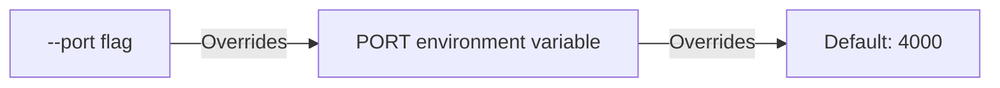

The `brick dev` and `brick start` commands run your Brick-TS application with automatic route discovery, port validation, and live reload.

## Development Server (`brick dev`)

Start local development with recursive file watching and debounced server restarts:

```bash
brick dev src/app.ts --port 4000
```

### Live Reload Behavior

When running `brick dev`:

1. **Entry File Loading**: The CLI resolves the application entry file. If an entry file path is provided but does not exist, the CLI exits immediately with an error.
2. **Watch Directories**: The CLI monitors `src/`, `app/`, and the parent folder of the entry file for changes (excluding `node_modules`).
3. **Application Lifecycle**: When files change, `brick dev` stops the existing server process, disposes the active application `Scope`, and starts a fresh instance with the updated module graph.

### Startup Route Banner

Upon startup, `brick dev` logs the gateway URL plus the built-in diagnostics endpoints:

```text
⚡ API Gateway running on: http://localhost:4000
🩺 Health check:        http://localhost:4000/_health
🗺️ Architecture graph:  http://localhost:4000/_brick/services
```

### Built-in Diagnostics

Every `Brick.app` serves two framework routes alongside your services:

- `GET /_health` returns `{ "status": "ok", "uptime": 12.3, "timestamp": 1699999999999 }`.
- `GET /_brick/services` returns the architecture graph (`{ "version": "1.0.0", "services": [...] }`) with each service's actions, HTTP methods, paths, and MCP flags. `brick info` exposes the same metadata from the CLI.

## Production Server (`brick start`)

Start the production server without file system watchers or development restarts:

```bash
brick start src/app.ts --port 8080
```

Or pass the port via environment variable:

```bash
PORT=8080 brick start src/app.ts
```

## Port Resolution and Validation

Port resolution follows a strict three-tier precedence:



Examples:

```bash
# 1. Defaults to 4000:
brick dev src/app.ts

# 2. Uses PORT=3000 from environment:
PORT=3000 brick dev src/app.ts

# 3. CLI --port 5000 overrides PORT=3000:
PORT=3000 brick dev src/app.ts --port 5000
```

Port numbers must be integers between `1` and `65535`. Invalid ports cause immediate process termination.
