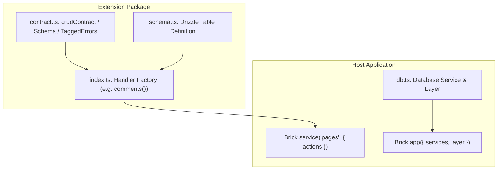

In Brick-TS, extensions are modular TypeScript packages that encapsulate domain tables, Effect Schema contracts, and handler factories.

## Architecture of an Extension

An Effect-native extension separates schema contracts from server implementations:



1. **Contract (`contract.ts`)**: Browser-safe schemas, `crudContract`, and `Schema.TaggedError` classes. Zero server or database dependencies.
2. **Table Schema (`schema.ts`)**: Drizzle table definitions.
3. **Handler Factory (`index.ts`)**: A function (such as `comments()`) that binds the contract to a store (`sqliteStore` / `postgresStore`), access policies, and lifecycle hooks.
4. **Host Integration (`app.ts`)**: The host application imports the actions, registers them on a `Brick.service()`, and supplies the database `Layer`.

## Minimal Example

Install and mount an extension on a service:

```ts title="src/app.ts"
import { Brick } from "@brickkit/core";
import { comments } from "./extensions/comments";
import { DatabaseLive } from "./db";

// 1. Instantiate extension actions
const commentActions = comments();

// 2. Register actions onto a service
export const pagesService = Brick.service("pages", {
  actions: {
    ...commentActions,
  },
});

// 3. Compose the application with dependencies
export default Brick.app({
  services: [pagesService],
  layer: DatabaseLive,
});
```

## Raw HTTP Routes (`Brick.route`)

For extensions that need custom HTTP endpoints (such as OAuth redirect callbacks, health probes, or webhook listeners), export a route using `Brick.route`:

```ts title="src/extensions/webhook.ts"
import { Brick } from "@brickkit/core";
import { HttpServerRequest, HttpServerResponse } from "effect/http";
import { Effect } from "effect";

export const webhookRoute = Brick.route(
  "POST",
  "/webhooks/stripe",
  Effect.gen(function* () {
    const request = yield* HttpServerRequest.HttpServerRequest;
    const body = yield* HttpServerRequest.toText(request);
    // Process webhook payload...
    return HttpServerResponse.jsonUnsafe({ received: true });
  }),
);
```

Pass custom routes into `Brick.app({ routes: webhookRoute })` to mount them alongside your services.
